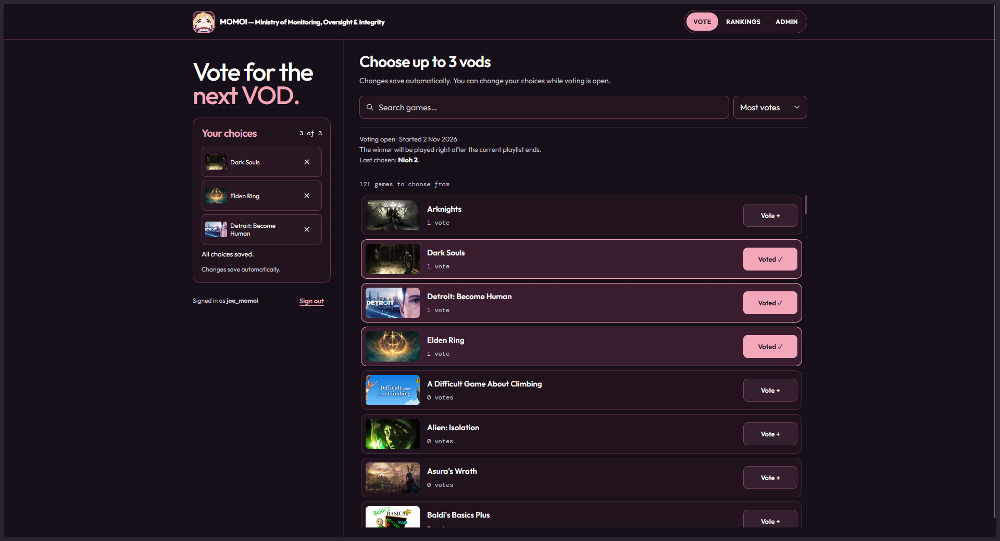

# Momoi

A website where Twitch viewers vote on what to watch next instead of leaving it
to chance. The winning playlist plays automatically.

**Built with:** TypeScript, React, TanStack Start, Convex and Cloudflare Workers.

[Architecture](docs/architecture.md)



## What it does

- Viewers choose up to three games or non-game playlists per voting round, with
  automatic saving and live aggregate rankings.
- Admins prepare YouTube playlists, manage the catalogue and moderate current
  ballots without exposing voter identities in public results.
- A paired Chrome/Edge extension coordinates a dedicated YouTube tab and saves
  playback progress. Native YouTube controls handle ordinary playback.
- Finishing a playlist selects the next winner from the community's votes and
  opens a new voting round while retaining completed ballots and history.

This is a community-specific application, including LacariVOD playlist validation,
not a turnkey service for arbitrary Twitch channels. The extension is installed
unpacked, rather than distributed through an extension store. See
[product behavior](docs/product.md) for eligibility, rotation and moderation rules.

## How it fits together

| Part | Technology and responsibility |
| --- | --- |
| Website | TypeScript, React and TanStack Start on Cloudflare Workers; voting, rankings and admin interface |
| Live backend | Convex queries, mutations and HTTP actions; authoritative ballots, moderation, rounds and playback runs |
| Authentication | Better Auth with Twitch; server-checked sessions and immutable Twitch IDs for admin authority |
| Playback extension | TypeScript Chrome/Edge extension; paired device, dedicated YouTube tab and progress checkpoints |
| Metadata | IGDB game lookup and YouTube Data API playlist preparation |

The website subscribes to Convex for live updates. The extension exchanges
assignments and progress with authenticated Convex HTTP actions; OBS captures
the browser independently. The former D1 database is retained historical data,
not the live voting authority.

Some useful implementation starting points:

- [Ballot replacement](convex/voting.ts): server-side eligibility and revision
  checks protect against stale tabs overwriting newer choices.
- [Playlist completion](convex/playbackRuns.ts): winner selection, completed-round
  inclusion, successor round and next playback run change in one mutation.
- [Playback client](extension/src/background.ts): device coordination and
  recovery work alongside the [YouTube page integration](extension/src/youtube.ts).
- [Reactive ballot state](src/client/reactive-ballot.ts): confirmed choices and
  recovery from uncertain saves remain distinct from optimistic UI state.

The [architecture](docs/architecture.md) explains these decisions and their
limits. The [release snapshot](docs/handoff.md#publication-and-verification-state)
distinguishes deployed behavior from checks still pending, including installed
extension playback and authentication edge cases. A successful build alone does
not prove uninterrupted stream playback.

## Development

Running your own instance requires a hosted Convex development deployment and
a registered Twitch OAuth application. Playlist preparation also needs a YouTube
Data API key. This checkout does not include private credentials or a sample
database. Read [configuration](docs/operations.md#configuration) before setup;
do not reuse the live community backend for experiments.

Use Node 22.12+ and install dependencies with `npm ci`. Run
`npm run configure:backend` once to sign in and select a hosted Convex project.
Configure its cloud development deployment and real Twitch credentials as described in
[operations](docs/operations.md#configuration), then run in separate terminals:

```powershell
npm run dev:backend
npm run dev
```

Open http://localhost:3000. Login goes through Twitch. There is no fixture server,
demo seed, or automatic database reset. Convex setup may create cloud resources;
choose the intended project and deployment explicitly. The frontend runs locally;
the database runs in Convex Cloud. Do not select a local Convex database.

On an empty backend, run `npx convex run setup:initialize` once to open the first
round, then add prepared playlists through Admin. Configure Twitch credentials
on the backend as well as frontend URLs; starting the servers alone does not
configure login.

## Verification

With the frontend endpoint variables configured:

```powershell
npm run typecheck
npx tsc -p convex/tsconfig.json --noEmit
npm run build
npm run build:extension
```

Check login/logout, voting, rankings, and admin actions in the browser against
the intended deployment. Votes persist. A vote reset requires separate confirmation.

The YouTube playback extension builds to `extension/dist/`. Its toolbar popup
pairs with Momoi and offers Play / Resume to restore the current playlist in a
dedicated YouTube tab. Native YouTube controls update saved progress; periodic
checkpoints cover unexpected exits. OBS only captures that window and has no
connection to Momoi. See the
[current verification and release status](docs/handoff.md) and
[installation and real playback checks](docs/operations.md#local-playback-extension).

## Deployment

After configuring and authorizing the production targets:

```powershell
npm run deploy
```

This builds for the production Convex deployment, publishes the backend, and
publishes the Worker. See [deployment](docs/operations.md#deployment) for required
variables and target selection. It does not seed or reset data.

## Documentation

- [Product](docs/product.md): behavior, privacy and visual identity.
- [Architecture](docs/architecture.md): authority, reactive data and authentication.
- [Operations](docs/operations.md): configuration, deployment and recovery.
- [Interface](docs/design.md): component and theme ownership.
- [Session handoff](docs/handoff.md): implementation, publication state and remaining work.
- [Agent guide](AGENTS.md): invariants and required checks.

This public repository begins with a clean source snapshot; private operational history is not included.

## License

Original project code is available under the [MIT License](LICENSE). Third-party dependencies, generated runtime declarations and artwork retain their respective rights and notices; MIT does not grant rights to third-party media. Artwork sources are recorded in `data/brand-artwork.json`.
